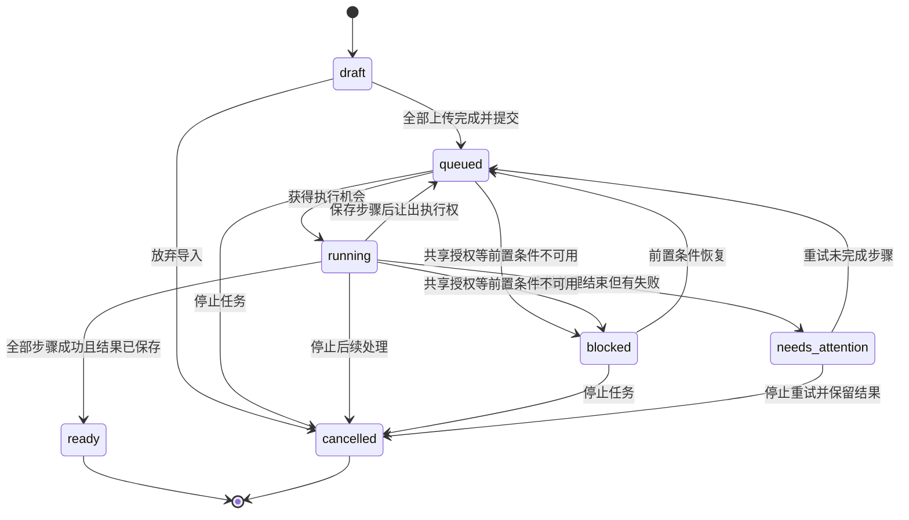

# 子计划：图片识别持久任务与跨设备恢复

记录日期：2026-10-30。

状态：本轮实现交付已完成（2026-10-30）；真机上传已通过，用户明确将锁屏恢复实测留到后续体验验收。本文单独新增，不修改或覆盖已有 plan。

## 1. 用户需求与成功标准

多张图片上传后，点击「识别并注音」应当提交一个服务端任务，并进入任务状态页面。任务执行不依赖手机保持亮屏、页面保持打开或浏览器继续发请求。同一个网站账号在其他设备登录后，也能看到正在执行的任务及已完成结果。

用户已授权实施本计划，本机代码与验证已完成；随后明确授权提交、推送并部署到树莓派。

验收的核心场景：设备 A 上传三张图片并提交，在第一张识别期间锁屏或刷新；设备 B 使用同一网站账号登录，能找到同一个任务，查看后续处理进度，最终打开整批校对结果。换设备无需重新上传或重新识别已保存的步骤。

准备阶段同样支持跨设备接续：A 上传第一张图片并收到服务端确认后，可以关闭页面或退出登录；B 登录同一账号，从「任务／导入草稿」打开同一草稿，继续上传第二、第三张，调整顺序后一起提交识别。新文章尚未正式保存时，凭同一个草稿 ID 延续同一次导入；已有文章则同时保留其目标文章 ID。

识别或注音持续失败时，以人工处理兜底：保留全部原图、已成功结果与图片顺序，允许逐图手动录入正文、手动添加或校正读音，再手动保存或追加。AI 成功不能成为进入编辑或保存文章的必要条件。

## 2. 实施前的问题根源

| 现有位置 | 当前行为 | 对新方案的影响 |
| --- | --- | --- |
| `client/components/ImageImport.jsx` | 图片队列在 React state，结果缓存在 `useRef(new Map())`；卸载会 abort | 顺序、方向、目标与批次执行进度不能依赖页面内存 |
| `client/image-import.mjs` | 浏览器逐图执行上传、旋转、识别、注音，再处理下一张 | 后面的图片可能还没上传，必须先把整批输入交给服务器 |
| `server/ai/routes.mjs` | 图片落盘并记录归属；单图识别和注音通过长 HTTP 请求执行，成功后写 `image_drafts` | 已有可复用的处理能力，但缺少批次编排、状态查询和恢复入口 |
| `server/providers/openai/index.mjs` | 全站共享的 AI runtime 同时执行一个请求 | 后台任务要排队，不能把运行时繁忙当作任务失败，也不能整批长占执行权 |
| `client/App.jsx` | hash 目前恢复文章／书籍；识别完成后的校对草稿留在内存 | 任务列表、详情与生成结果需要稳定地址和服务端读取入口 |
| `server/app.mjs` | 保存图片识别记录依赖按 `image_id` 唯一的 `image_drafts` | 任务必须保留自己的结果快照，不能被同图其他处理覆盖 |
| `server/index.mjs` | 停服时主要等待 HTTP 请求结束，再关闭 AI 与数据库 | 增加 runner 后需要显式安排后台停止、结果写回与数据库关闭顺序 |

断连后当前单图请求可能仍在服务器完成并保存；真正缺少的是继续下一步的执行者，以及把这些结果重新找回来的整批任务记录。

## 3. 建议的用户流程

1. 继续先选择书籍／文章、添加图片、排序及调整方向。选图后开始上传，逐张显示「待上传／上传中／已上传／上传失败」。全部原图上传与 AI 执行分开。
2. 准备信息作为服务端导入草稿保存，包括图片清单、顺序、方向、标题和目标；此时不执行 AI。草稿创建后即使用稳定地址 `#tasks/<id>`，未提交时呈现准备页，刷新或换设备后直接恢复已上传清单，并提供「继续上传」。提交后同地址呈现任务详情。尚未传完的本地文件需要重新选择，不能承诺浏览器关闭后还能继续发送这些字节。
3. 所有图片上传并经服务器确认、准备信息保存成功后，启用「识别并注音」。点击时原子冻结输入并提交，返回任务 ID；立即进入 `#tasks/<id>`，不等待任何 AI 步骤。
4. 提交成功后显示「任务已提交，可以离开此页面」。离开任务页、锁屏、退出网站登录或登录到其他设备都不取消任务。
5. 增加常驻「任务」入口，列表优先展示处理中、等待恢复、待处理问题和待校对任务，同时可查看历史与未提交草稿。移动端也能直接找到入口。
6. 任务详情显示图片总数、完成／失败数量、逐图状态、当前步骤、提交／开始时间、已用时与明确错误。AI 阶段显示实际步骤和张数，不伪造百分比或预计完成时间。
7. 任务完成后保持在详情页，显示「开始校对」；若用户在阅读其他文章，只更新任务提示，不强制跳转。
8. 打开结果时读取服务端生成草稿，复用现有逐图校对、图文排序与移除能力；用户保存后才新建文章或追加。完成识别与保存文章分别记录。
9. 识别失败的图片提供「手动录入正文」，注音失败提供「手动注音」。即使整批图片均未识别成功，也能保留原图进入逐图录入；不要求无限重试或耗尽重试次数后才能手动处理。

任务详情断网只提示「暂时无法同步状态」，不把任务标成失败。页面恢复可见或网络恢复时立即重新读取；等待期间可停轮询，后台执行不受影响。

准备页的关闭、返回或退出登录只离开页面，保留服务端草稿；与明确的「放弃导入草稿」区分。每张图片获得服务端保存确认后显示「已上传」，准备信息同步成功后可提示「草稿已保存，可在其他设备继续」。另一设备通过同一草稿 ID 接续，不按相同文章标题或相同目标文章自动合并不同导入。

## 4. FSM 与状态语义（建议）

一批图片对应一个任务，每张图片单独保存步骤和结果。任务状态与单图阶段分开，避免批次状态数量随图片数增长。

| 状态 | 含义 |
| --- | --- |
| `draft` | 导入准备阶段，可能仍有图片未传完，尚未提交 AI |
| `queued` | 已提交且可执行，等待共享执行名额或下一轮调度 |
| `running` | 当前正在执行某张图片的某个步骤 |
| `blocked` | 网站 AI 未连接、授权失效等整批前置条件需要恢复；说明原因与下一步 |
| `needs_attention` | 本轮能执行的图片已处理完，仍有识别／注音失败；即使全部失败也保留原图与错误 |
| `ready` | 整批识别与注音成功，服务端校对结果已保存 |
| `cancelled` | 已停止后续处理，保留已上传图片与已落盘结果 |

`ready` 表示计算完成，不表示已写入正式文章。另存结果使用状态（未采用／已保存）、保存后的文章 ID 和结果版本；已采用的任务默认进入历史，重复打开直接提供文章入口。人工补录不把失败步骤伪装为 AI 成功；保留原失败记录，以人工正文／读音与采用记录表达兜底处理结果。

每张图片保存当前阶段 `prepare / recognize / annotate`，以及该阶段的 `pending / running / succeeded / failed`、结果、尝试次数与错误。准备阶段包含最终方向保存及校验。识别结果落盘后才进入注音；注音失败仍保留识别正文。转为人工处理时保留已有处理结束时间，避免把等待校对的时间算入识别耗时。

上面的 `running → queued` 是后台调度细节，界面可合并显示「处理中」，避免每个步骤之间反复闪烁「排队／执行」。服务重启时，将遗留的执行中步骤恢复为可调度状态，保留所有已保存成功结果。

## 5. 数据、接口与执行方式

### 持久数据

复用现有 SQLite 与图片目录，建议新增两张表，不引入独立队列服务：

- `image_tasks`：任务 ID、网站 `user_id`、状态、任务版本、提交幂等标识、标题、目标书籍／文章、新书名、目标文章参考版本、时间、阻塞原因及结果采用记录。主采用保存输入哈希；用户明确另存的副本另记哈希与文章 ID，保证各自请求重试幂等。
- `image_task_items`：任务内图片 ID、固定顺序、上传条目标识、原文件名、上传状态、原图及实际处理版本、目标方向、各步骤状态、识别与注音结果快照、错误、尝试 token 和重试时间。没有 AI 结果的图片也保留有效来源记录，可关联用户手动录入的正文；记录人工处理来源，不伪造模型识别结果。

人工校对期间明确发起的 AI 补音单独缓存最近三份服务器结果，不改已固定的正文及任务版本。采用时按当前图片正文及读音精确匹配缓存，保留匹配的模型与耗时记录；手输正文仍不冒充 OCR 成功，客户端自报的识别记录不会被采用。

整批 HTML 结果从有序图片结果生成，沿用现有来源图片、振假名和受控 HTML 规则。任务自己的快照是恢复依据；`image_drafts` 可以继续兼容现有功能，但不能作为任务唯一结果来源。保存正式文章时，服务端校验任务及图片归属并使用对应结果记录，不信任客户端伪造的识别元数据。

草稿和任务都归属稳定的网站账号，不绑定当前设备、登录会话或 AI 授权账号。所有列表、详情、图片、结果、重试、停止和采用接口均校验 `user_id`。

### 接口职责

接口命名可按现有风格调整，职责建议如下：

| 接口 | 用途 |
| --- | --- |
| `POST /api/image-tasks` | 幂等建立不执行 AI 的导入草稿 |
| `PATCH /api/image-tasks/:id` | 按版本更新准备信息，仅允许未提交草稿修改 |
| `POST /api/image-tasks/:id/items` | 幂等添加待上传条目到同一未提交草稿，支持另一设备继续添加；不覆盖整批既有图片清单 |
| `POST /api/image-tasks/:id/items/:itemId/image` | 单图上传并绑定到草稿条目；重复上传请求可确认既有结果 |
| `POST /api/image-tasks/:id/submit` | 校验全部输入并冻结；数据库提交后返回 `202` 与稳定任务 ID |
| `GET /api/image-tasks` | 当前账号的任务列表、状态计数与分页 |
| `GET /api/image-tasks/:id` | 任务详情及逐图进度，不默认传输大份正文 |
| `GET /api/image-tasks/:id/result` | 读取持久校对结果，包含原图、部分成功结果及失败清单；全批识别失败也能提供手动录入的初始草稿 |
| `POST /api/image-tasks/:id/retry` | 只将失败或未完成步骤重新排队 |
| `POST /api/image-tasks/:id/cancel` | 按预期任务版本停止后续处理；需要校对部分结果时，一并原子固定结果版本 |
| `POST /api/image-tasks/:id/apply` | 按任务／结果／目标文章版本，原子新建或追加文章，并记录采用结果 |

草稿首次建立及提交都要处理「服务器已成功但响应丢失」：用账号范围内的幂等标识和唯一约束找回原记录。重复提交同一草稿只返回同一个任务；同一标识配不同输入要拒绝。提交失败时保留已上传图片。

草稿跨设备修改通过任务版本、稳定条目 ID 和幂等上传保护。A、B 同时添加、删除、排序或提交时，服务端拒绝过期修改，客户端重新读取最新草稿并保留本机尚未上传文件，不用旧的完整列表覆盖其他设备新加的图片。新增条目、上传绑定与提交均校验草稿状态；B 打开准备页后若 A 已提交，B 应同步到任务详情，晚到上传不能混入冻结批次。另一设备留下的未上传条目可以重新选择文件或明确移除，不阻止 B 继续添加新图片；提交前仍需处理全部未上传条目。

### 后台 runner

- runner 由应用启动，在服务端持续调度，不依赖某个请求、轮询或 Service Worker 是否还活着。第一版沿用现有单服务进程部署，不支持多实例同时共享数据库执行。
- 提取并复用现有识别、注音及验证服务函数；路由和 runner 调用同一业务能力，不在服务器上发 HTTP 请求调用自己的旧接口。
- 每次事务领取一个步骤，记录尝试 token；每完成一次识别／注音就把结果与步骤状态一起提交。只有当前有效尝试可以写回，旧尝试或停止后的迟到结果不能推进任务。
- 统一仲裁现有共享运行时执行权，任务和问答／分句均经同一个入口申请；繁忙时等待，不能只依靠释放锁后碰运气抢占。后台批次按步骤轮转，步骤之间优先执行已等待的交互请求；有后台步骤等待时，最多连续执行一个插队的交互请求，防止任一侧长期饥饿。问答／分句的等待仍属于当前 HTTP 请求，断连后可移除等待项，本轮不把它们改为持久任务。
- 暂时性网络错误、超时可有限退避重试，自动重试最多两次并持久化计数和下次时间；用尽后记录该图错误，继续其余图片。繁忙等待不消耗重试次数。
- 授权失效等整批问题进入 `blocked`，普通成员只能看到必要说明；网站拥有者恢复共享授权后重新调度，不要求原提交设备在线。定期检查有退避，避免空转。
- 启动时恢复未完成任务，只重做中断且没有成功 checkpoint 的步骤。模型调用与数据库写入无法形成一个事务，因此不承诺模型调用恰好一次；承诺已保存步骤不重做、不重复拼接结果。
- 停服时先停止领取新步骤，结束或中断当前执行并使其可恢复，等写回流程收束后再关闭数据库；处理好现有同步 `close()` 接口与异步 runner 的生命周期。
- 「停止任务」建议定义为停止后续步骤并忽略无效迟到结果。第一版不通过全局 `runtime.stop()` 强行杀掉其他任务或问答；正在执行的一步可能需要等待结束才释放名额。

## 6. 图片版本、校对与采用结果

- 提交前可排序、删除、旋转；提交后固定输入。方向处理应记录目标方向和实际像素版本，恢复时先确认状态，不重复累加旋转。已提交图片不能被准备页改写；如底层允许保存新方向，任务必须仍能读取固定版本或明确阻止冲突。
- 提交的异步输入检查期间也锁定全部输入图片，使用引用计数保护重叠提交，避免读完第一张、等待其他图片期间被另一请求旋转。后台固定结果后，校对器可明确保存人工调整的方向。
- 同一未提交草稿允许不同设备继续添加图片。已有文章在一批任务提交后还需加图时，使用新的导入批次追加到同一目标文章，不修改已提交任务的输入；如果新文章尚未保存，先保留原任务及结果，再在文章保存后继续追加。
- 任务保留独立结果。其他设备修改、移除原目标文章或书籍，不影响继续识别；进入校对时读取最新目标，提示变化。目标已删除时，可将结果另存为新文章，不需要重识别。
- 追加沿用现有「读最新文章 → 合并图片及正文 → 校对 → 按 revision 保存」规则。保存遇到新修改时拒绝覆盖，并保留任务结果及当前校对内容；图片总数上限在提交和最终采用时都检查。
- 最终创建／追加文章与任务采用记录必须在同一数据库事务内完成。重复点击、请求重试、两台设备同时采用同一结果，只能保存／追加一次；响应丢失后可读取文章 ID 确认成功。
- 主结果采用后，相同内容的请求才算幂等重试；另一设备提交不同人工修改返回冲突并保留当前编辑。用户可以基于最新校对内容明确另存新文章，副本自身幂等，原文章与主任务的采用目标保持不变，不能把另一份人工稿静默当作已经保存。
- 新建书籍建议延迟到采用结果时，与文章创建一同处理，避免任务失败或重复采用留下空书籍。
- 单图注音失败时保留「先校对正文」和「手动注音」。已有识别正文的图片可继续校对；识别失败的图片可对照原图手动录入正文。全批识别失败时仍提供「手动录入正文」，不能只剩重试或停止。
- 部分结果进入校对或手动录入前，带预期任务版本，在同一事务中停止后续处理、作废当前尝试 token 并固定结果版本，再读取该版本进入编辑。不能先读取结果再另行停止，也不能用 GET 隐式改变任务状态。采用前明确显示哪些图片尚无正文或缺少注音，不把缺失图片静默当作已导入成功。
- 手动录入继续逐图关联原图、顺序和正文，不要求用户删除失败图片后另建纯文字文章。修改／增加读音沿用人工读音标记 `manual`；允许部分或全部不注音时先保存文章，之后继续人工补全。
- 保存路径必须支持「原图 + 手动正文」以及「已有正文 + 手动读音／无读音」。调整现有 `articleImages()` 要求新图片必须已有 `image_drafts` 的门槛，改为校验账号归属、任务来源与有效正文；仍校验通用内容和版本规则，但不要求 OCR 或自动注音成功。原 AI 错误记录与人工处理来源分别保留。
- 如果只采用已有识别或手动录入正文的图片，任务保留原图、未完成清单及本次采用的图片集合。尚未录入正文的图片明确保留为待处理，或由用户选择排除；最终文章仍需有非空正文。已采用任务不能直接重试并再次整批追加；其余图片后续处理须走单独明确操作，避免重复导入。
- 进入人工校对后，迟到 AI 结果不能覆盖人工文字或读音。第一版保证原始生成结果可恢复；尚未保存的人工改动继续沿用现有离开提醒。人工校对自动保存及跨设备协同编辑另行讨论，不把它们默认为已实现。

## 7. 页面更新、数据保留与范围

第一版使用普通状态轮询：可见详情页约每 2 秒同步，任务列表可降低频率；页面隐藏暂停轮询，重新可见立即同步。通过任务版本避免旧响应覆盖新状态，切换账号时清空旧账号页面缓存。任务 API 沿用私有、不缓存策略，不把账号数据放进公共 PWA 缓存。

已上传草稿、未采用任务结果及失败记录默认保留，不增加自动清理。任务列表分页，原图只按需读取。停止任务不等于删除图片；将来做清理时必须检查正式文章和其他任务引用，不能沿用「删除任务就删原图」的规则。

本轮聚焦图片导入任务。离线提交、浏览器关闭后续传尚未上传字节、系统推送、邮件通知、问答任务化、分布式 worker、全站任务平台与人工编辑自动保存均不包含在第一版承诺中。

## 8. 实施顺序与验收

| 顺序 | 工作 | 完成条件 |
| --- | --- | --- |
| 1 | 持久任务、单图步骤、版本与幂等接口 | 可以创建、提交、查询任务；跨账号访问被拒绝；重复请求不产生重复任务 |
| 2 | 识别／注音服务提取与 runner | 无任何浏览器连接时仍处理完整批次；步骤结果持久；公平排队和失败策略有效 |
| 3 | 服务重启、停止、授权恢复与迟到写回 | 已完成步骤不重跑；旧尝试不推进状态；授权恢复后续跑；数据库关闭无后台写入竞态 |
| 4 | 准备页分离上传、跨设备续加图片、任务列表与固定详情地址 | A 上传一张退出后，B 能打开同一草稿继续上传并一起提交；所有图片上传完才可提交；刷新、返回、重开及登录恢复正常 |
| 5 | 持久结果接入校对、手动兜底及原子采用 | 全批识别失败也能对照原图手动录入并保存；手动注音或无注音可保存；目标冲突不覆盖；重复／并发采用不重复追加 |
| 6 | 回归及真实手机验证 | 桌面、手机触屏模拟通过；真机锁屏后由另一设备观测后台仍在执行 |

关键验证场景：

- [x] 三张及更多图片全部上传后提交；浏览器刷新、关闭页面或退出登录后，后续图片仍完成。已有真实订阅任务在提交连接关闭后的执行证据。
- [x] 用户真机上传体验核对：2026-10-30 反馈上传部分 OK；该反馈仅覆盖上传。
- [ ] 后续体验验收：真实手机锁屏或系统回收页面后，重开或另一设备登录观察任务继续及结果恢复（用户明确留待后续，不作为本轮实现交付的阻塞项；未宣称已实测）。
- [x] A 设备提交、B 设备同账号查看相同顺序、方向、步骤、时间与结果；退出／过期再登录也能找回。
- [x] A 上传一张且服务端确认后，分别关闭页面和退出登录；B 登录同账号打开同一未提交草稿，看到原图及目标，继续上传两张后提交，三张均按最终顺序处理到同一篇文章。
- [x] A、B 同时修改草稿时不覆盖彼此的新图；B 仍在准备页时 A 提交，B 的晚到上传被明确处理，不混入冻结批次。未上传条目可重选／移除，未提交草稿不会仅因离开页面而被放弃。
- [x] A、B 不同账号无法读取或操作彼此的任务、原图、结果，成员无法看到共享 AI 账号详情。
- [x] 创建草稿、上传、提交、采用的响应分别丢失后重试；不丢已上传图片、不重复任务、不重复追加。
- [x] 在 OCR 成功后、注音中途及结果写回边界重启服务；恢复点正确，运行 token 拒绝旧结果。
- [x] 第二张注音失败，第一张成功结果保留，第二张正文可用，第三张继续；重试只补失败步骤。
- [x] 全批识别持续失败后进入手动录入，逐图输入正文并保存／追加；原图、图片顺序和来源关联经重开仍正确，不要求 AI 成功。
- [x] 部分图片识别失败时，成功正文保留，仅手动补录失败图片；进入人工处理后的迟到结果不能覆盖输入。
- [x] 注音持续失败时，可手动添加／校正读音，也可保留无注音正文先保存；人工读音标记为 `manual`，失败记录不冒充 AI 成功。
- [x] 单图识别失败、全批失败、AI 未授权、授权中途失效、暂时网络错误均有可恢复状态，不能永久停在执行中。
- [x] 多用户同时提交多图任务，按步骤推进；任务不能因共享运行时忙而失败；问答与分句仍可正常使用。
- [x] 准备页旋转后提交，重试／重启不重复旋转，原图版本、正文来源和注音配对正确。
- [x] 任务期间从另一设备修改／删除目标文章或书籍，结果仍可查看；采用不会覆盖其他设备修改。
- [x] 两设备同时采用、保存超时后重试，都只导入一次；结果版本冲突不会丢人工校对文字。
- [x] 两设备分别人工校对同一任务，A 保存后 B 的不同内容得到冲突；B 继续修改并明确另存时保存最新版，原文章和主采用记录不变，副本请求重试不重复创建。
- [x] 停止任务、先校对正文之后，迟到结果不会重新启动任务、覆盖人工校对或自动追加。
- [x] 上传中断能恢复已上传条目，缺少本地字节的图片明确要求重新选择；未全部上传不能显示提交成功。
- [x] 停留在其他文章阅读时，任务完成不强制跳走；网络中断不误报任务失败。

已补充状态机、接口、重启恢复和跨浏览器会话的有效回归。旧的浏览器内存队列、组装草稿与方向缓存函数已移除，其七个旧编排测试由持久任务集成回归替代；文件选择校验和未提交上传取消的保护继续保留。

实施后执行 `npm run check`、`npm run test:browser`、`npm run test:browser:ai`；涉及构建的命令顺序运行，避免同时改写 `dist`。自动化用明确的 AI 替身检查执行次数与恢复位置；真实手机锁屏与真实模型分别核对，不能用模拟浏览器替代真机结论。树莓派部署继续沿用默认跳过完整测试的既有策略。

## 9. 已确认交互与其余建议

已明确的需求是「点击提交任务 → 任务状态页 → 不依赖页面继续执行 → 同账号跨设备可见」。

用户已于 2026-10-30 确认以下三项：

1. 任务完成后保留服务端待校对草稿，由用户手动保存或追加到文章。
2. 单张图片识别或注音失败后继续处理其余图片，保留全部成功结果，最后集中显示问题；重试只补失败步骤，不重做已成功的步骤。
3. 识别持续失败以手动录入正文兜底，注音持续失败以手动添加／校正读音兜底；原图和成功结果继续保留，即使全批识别失败也能进入人工处理并保存。

补充需求：支持 A 上传一张图片后退出，B 使用同账号继续向同一未提交导入草稿添加图片，最后保存到同一篇文章。服务端草稿持久化与跨设备继续上传纳入计划范围。

实施范围包括停止后续处理并保留结果；尚未保存的人工编辑继续使用离开提醒，不承诺跨设备恢复。

## 10. 实施记录

2026-10-30 已实现：

- 服务端使用 SQLite 保存任务与逐图步骤；后台 runner 独立执行，支持 checkpoint、重启恢复、授权阻塞恢复、有限重试和停止。共享 AI 执行权由交互／后台队列统一仲裁。
- 准备页选图即上传，同账号可跨设备恢复未提交草稿；固定地址进入任务详情，状态查询与执行生命周期分离。重复提交、上传响应丢失、过期修改和另一设备抢先提交均有恢复路径。
- 识别全失败仍可手动录入，注音失败可手工补音或先保存正文。空白来源图明确标为待录入；进入人工编辑后的迟到结果不能覆盖人工内容。
- 结果采用与文章创建／追加在同一事务内；支持重复采用确认、并发保护、目标版本冲突后保留最新校对内容另存，新建书籍延迟到保存时创建。文章和任务来源记录均由服务器校验。
- 新增任务、队列、停服与浏览器回归；旧图片导入测试已迁移到提交任务、等待结果、显式校对的流程。29 项服务端任务集成回归覆盖持久化、恢复、并发输入及人工稿保存。

用户已在真机测试上传部分并反馈 OK。未据此宣称真机识别期间锁屏／系统回收的恢复已验收；这些场景目前有服务端无连接执行、跨登录会话和浏览器模拟的验证，真机实测单独保留。

用户随后明确选择「留到后续，本轮完成实现交付」，因此本轮实现与验证已收尾；真机锁屏恢复作为后续体验验收项保留。

真实订阅验证已通过：`npm run verify:image-tasks -- --image=/绝对路径/原图.png`。仅使用网站拥有者已有授权，所有新账号、任务和原图写入隔离的 `artifacts/image-tasks-live/`，未创建或修改现有网站文章。一次真实识别及一次注音得到 536 字正文与 104 个读音，正文逐字一致；提交连接关闭、第二独立登录会话读取、原图 SHA-256 及服务重开恢复共 11 项检查通过。报告位于 `artifacts/image-tasks-live/0f024bd6-e3e5-416a-af65-dd9400f24b59/report.json`。

最终本机验证：

- `npm run check`：281 项单元／接口测试全部通过，生产构建通过。旧内存队列的七个测试随已停用函数移除，由新的持久任务测试取代；未移除现用文件选择与上传校验。
- 常规阅读／PWA 浏览器回归：桌面、手机模拟共 30 项通过。
- 账号／AI／任务浏览器回归：96 个唯一场景通过。其中最终任务专项桌面、手机共 18 项全部通过，含跨设备续传、人工兜底、冲突后继续修改并另存。其他 78 项在完整回归中通过。
- 浏览器模型／授权使用明确测试替身；真实模型结果另见上述隔离验证。已人工查看桌面和手机任务页截图，图片清单、按钮、时间与小屏布局正常，无横向溢出。
- `git diff --check` 通过。最后一次构建的客户端 JS／CSS 与浏览器回归使用的产物一致；树莓派部署默认跳过完整测试的策略保持不变。

保留启动本轮前已有的其他文档改动，未覆盖主计划。用户随后授权本次提交、推送和树莓派部署；按既有脚本先备份数据，再安装依赖、构建、重启并验证健康状态，服务器默认不重复执行完整测试。真机锁屏恢复仍按用户安排留到后续体验验收。
